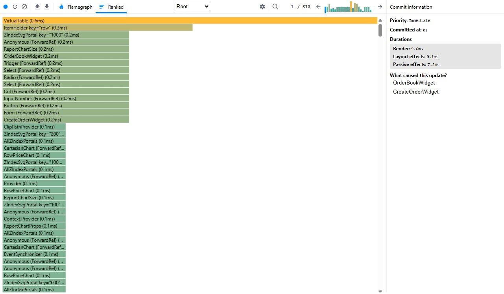

# Kairo Trading

A Next.js app built with TypeScript, SCSS modules, Ant Design, and Redux Toolkit.

## One command

```bash
npm run launch
```

This command install dependencies, lint, run component and E2E tests, then run the mock and development server together


## Productivity evidence

Below is result of 10 sec manipulation with Whatchlist and CreateOrder widgets:



## Features could be added next

- User's order history
- User's assets 
- Pair's filtering
- Pair's sorting
- Favorites market
- Spread chart

## Scripts

- `npm run launch` — install dependencies, lint, run component and E2E tests, then run the mock and development server together
- `npm run dev` — start Next.js only
- `npm run dev:ws` — launch the WebSocket mock first and Next.js together
- `npm run mock:ws` — run the persistent-in-memory WebSocket mock
- `npm run build` — create a production build
- `npm run start` — start the production server
- `npm run lint` — run ESLint
- `npm run lint:fix` — run ESLint with automatic fixes
- `npm test` — run Jest and React Testing Library tests
- `npm run test:e2e` — run Playwright browser tests in Chromium
- `npm run test:e2e:visible` — run Playwright tests in a visible Chromium window

`npm run launch` runs `npm install`, `npm run lint`, Jest in serial mode
(`--runInBand`), and `npm run test:e2e`, stopping if any step fails.
Install Chromium first with `npx playwright install chromium`.
Once those steps succeed, `mock:ws`
and `dev` run concurrently without waiting for mock readiness; Ctrl+C stops both,
and either process exiting stops the other. Ensure their ports are available.
This command does not build or start a production server.

## Component tests

Jest uses `next/jest` with jsdom, stylesheet mocks, and the `@/` alias.
`jest.setup.ts` adds jest-dom matchers and the browser APIs needed by Ant Design.
The create-order tests render the real form with a fresh Redux store per test,
covering Market Buy/Sell pricing, live updates, reconnection, delayed quote loading,
Limit prefilling and precision, copying the reference price, and missing inputs.

Run the focused suite with:

```bash
npm test -- src/components/widgets/createOrder/index.test.tsx
```

## Browser automation

Install Chromium once, then run the Playwright suite:

```bash
npx playwright install chromium
npm run test:e2e
```

Playwright starts the development server on port 3000, or reuses a running server
locally. The development server is required because the quote feed is disabled in
production. The test intercepts the quote WebSocket, so no mock server is needed.
It creates a Buy Limit order, opens the preview, injects an increased ask, confirms
the new price, and submits the reopened preview. It verifies the updated price,
estimated cost, dialog transitions, and final success message.

Jest excludes the `e2e` directory. Playwright saves traces for failures in the
ignored `test-results` directory.

Open [http://localhost:3000](http://localhost:3000) to view the app.

## Project structure

- `src/app/page.tsx` — home page
- `src/components/dashboard/index.tsx` — quotes and order dashboard layout
- `src/components/widgets/frame/` — shared widget container, heading, and styles
- `src/components/widgets/orderBook/index.tsx` — client-side quote table
- `src/components/widgets/orderBook/index.module.scss` — quote table styles
- `src/components/virtualTable/index.tsx` — generic virtualized table
- `src/components/virtualTable/index.module.scss` — shared table layout and styles
- `src/components/widgets/createOrder/index.tsx` — Ant Design mock order form
- `src/components/widgets/createOrder/index.module.scss` — order form styles
- `src/components/header/` — application header
- `src/components/live-indicator/` — Redux-driven connection status and pulsing Live dot
- `src/components/dataFeed/index.tsx` — development WebSocket feed and reconnect lifecycle
- `src/components/dialog/index.tsx` — reusable named Redux-controlled Ant Design Modal
- `src/components/dialogs/orderPreview/` — order preview content, actions, and styles
- `src/components/dialogs/priceConfirmation/` — adverse price-change confirmation
- `src/app/providers.tsx` — application-wide Ant Design theme, message context, and Redux providers
- `src/redux/store.ts` — Redux store configuration
- `src/redux/hooks.ts` — typed Redux hooks
- `src/redux/units/common/` — connection actions, reducer, and selectors
- `src/redux/units/market/` — quotes, opening records, and active pair selection
- `src/redux/units/dialog/` — named dialog actions, reducer, and selectors
- `src/interfaces/` — shared quote, asset, order, dialog, and Redux state types
- `src/utils/parsePairSymbol.ts` — base and exchange currency extraction
- `scripts/mock-quotes.ts` — standalone Node WebSocket mock server
- `src/mocks/data.ts` — initial mock pairs and assets
- `src/app/page.module.scss` — page-scoped styles
- `src/app/globals.scss` — global styles and design tokens

## Mock quote feed

The development quote feed connects to `ws://127.0.0.1:3002/mock/quotes`.
The Node mock server maintains one shared in-memory snapshot and continues updating
it even without connected browsers. Reloads and additional tabs receive the latest
200 pairs before live updates. Restarting the mock server resets the data.
The feed sends one JSON array every 100 ms containing a random 30–50 ticks,
controlled by `TICKS_PER_BATCH_RANGE`, cycling through all pairs (approximately
300–500 ticks per second total). Initial snapshots are sent as a single JSON array
containing all pairs. Snapshot ticks are additional
messages, not part of the live tick rate. Actual throughput depends on server load.
`WRONG_SEQ_FREQUENCY` controls the probability of broadcasting a stale sequence
(3% by default). These updates have a sequence below the pair's latest valid one
and do not replace the server snapshot. The market reducer ignores updates whose
sequence is not strictly newer than the stored record.
The feed is not used in production.
Each mock connection is closed after a random 1–30 seconds to simulate a disconnect.
The browser retries after a random 1–5 seconds following closure (including failed attempts)
and receives the latest snapshot on reconnect. Quote generation continues throughout;
the connection indicator shows Disconnected until the new socket opens.

Set `MOCK_WS_PORT` to change the server port and `NEXT_PUBLIC_MOCK_WS_URL` to change
the browser's endpoint (restart Next.js after changing it). HTTPS pages need a
secure `wss://` endpoint, for example through a local TLS proxy. The server binds
only to `127.0.0.1`; `http://127.0.0.1:3002/health` reports readiness.
No MSW service worker is started or required.

## Virtualized watchlist

The watchlist header includes a clearable symbol search. It matches partial symbols
case-insensitively, ignores surrounding spaces, and keeps filtering as live quotes
update. Clearing the input restores all rows.

The currency-pair table uses TanStack Virtual to render only visible rows plus
five overscan rows on either side. Vertical scrolling stays inside the table body
so column headers remain visible, with spacer rows preserving the full scroll height.
The order book samples the latest Redux quote snapshot every 1,000 ms,
retaining each displayed record's timestamp for change detection. Clicking a row
prefills a Buy Limit order; clicking its Sell (Bid) cell prefills a Sell Limit order.
Updated rows briefly flash and fade over 450 ms; the animation is disabled when
reduced motion is requested.

## Accessibility

Watchlist bid and ask prices are native buttons with explicit Sell/Buy names.
Use Tab to reach them and Enter or Space to select a pair and prefill the order
form. The table body is also focusable for keyboard scrolling through virtualized
rows. Forms and dialog actions use native or Ant Design keyboard controls, and
interactive elements have a visible focus outline.

Updated rows show persistent Up, Down, or Unchanged text alongside the pair, so
price flashes do not rely on color alone. Chart accessible names include the first
and last midpoint and trend direction. With `prefers-reduced-motion: reduce`,
quote flashes and the Live pulse are disabled; other animations and transitions
are reduced to near-instant durations and smooth scrolling is disabled.

Playwright checks keyboard selection, order preview cancellation, visible focus,
non-color movement labels, and reduced-motion behavior in both motion modes.

`VirtualTable<TItem>` takes `items`, `columnCount`, and `getItemKey(item)` for stable
row identity. `renderHeader(rowProps)` and `renderRow(rowProps, item)` each return
a complete `<tr>` element. Spread the supplied props onto the header row to retain
its accessibility attributes. For body rows, destructure `key` from `rowProps` and apply it
explicitly (`<tr key={key} {...rowProps}>`), spreading the remaining props onto the
row to preserve measurement and accessibility attributes.
Keep these render callbacks inside a Client Component.

The Chart column uses Recharts through `RowPriceChart`. Each mounted row stores
midpoint prices (`(bid + ask) / 2`) and quote timestamps in component state,
appending a point when either changes. The line uses timestamps for its horizontal
axis and skips duplicate samples. History is local to the row and resets when
virtualization unmounts it or its symbol changes.

## Mock orders and dialogs

The mock order form supports Market and Limit orders. Limit orders require a
positive limit price at the selected pair's price precision; market orders hide
that field. Previews include the order type and limit price when applicable.
The Buy/Sell button opens an order preview with a fixed snapshot of the quantity,
price, and estimated cost. It is disabled while disconnected or when the estimated
cost is invalid. Market previews capture the latest selected quote (ask for Buy,
bid for Sell); Limit previews use the entered limit price.

The preview shows live percentage movement relative to its price, formatted with
Numeral. Positive changes use `--buy-color`, negative changes use `--sell-color`,
and zero or unavailable changes retain the default text color. Submit Buy/Sell
uses the preview total, shows `Order is submited. Total: {Total} {Asset}`, and closes
the dialog. Cancel closes without submitting. These are simulated orders only;
no live trade is placed.

Named dialogs use the existing Redux store and Ant Design Modal. Register payload
types in `src/interfaces/dialog.ts`, render an `AppDialog` with its `name` and a
data render callback, and mount it inside the Redux provider. Open it with
`dispatch(DialogActions.show({ name: "orderPreview", data }))` and close it with
`dispatch(DialogActions.hide("orderPreview"))`. The close button, Escape, and
backdrop also dismiss the dialog.

If live ask rises above the preview price for Buy, or live bid falls below it for
Sell, the preview is replaced by a Price confirmation dialog. This applies to
Limit previews only, with no tolerance threshold; Market previews never open price
confirmation. Confirm price change
reopens the preview using the displayed new price and recalculates the total;
Cancel dismisses it without submitting. Further adverse changes require another
confirmation. Submission checks the latest quote again before showing success.